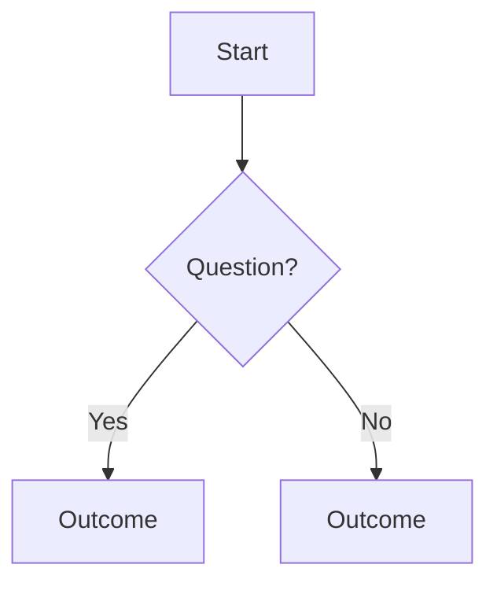

# <Title>

## The rule in one line

<Paraphrase. No pasted rule text.>

## Decision tree

## Common cases

| Situation | Usual answer | Why |
|---|---|---|

## Coding notes

-

## Pin log

| Date | What changed | Source |
|---|---|---|
| YYYY-MM-DD | File created | |
