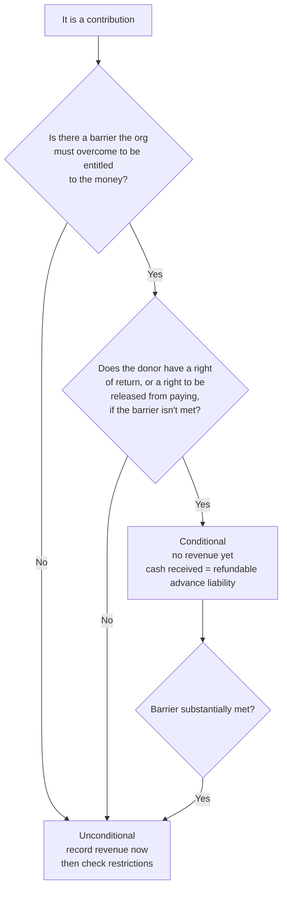

# Conditional or unconditional?

## The rule in one line

A contribution is conditional only when the agreement has **both** a barrier the organization must overcome **and** a right for the donor to get the money back (or to be released from paying) if the barrier isn't met. If either piece is missing, it's unconditional and is recorded when received or promised.

## Decision tree

## Indicators of a barrier (weigh together; none is decisive)

1. **A measurable, performance-related target.** Examples: serve 500 households, raise a matching amount, hold a specified number of sessions.
2. **Limited discretion over how the activity is carried out.** Example: the agreement dictates staffing qualifications or protocols in detail.
3. **The stipulation is tied to the purpose of the agreement.** Administrative requirements such as routine reporting usually are not barriers.

## Common cases

| Agreement language | Barrier? | Return or release? | Result |
|---|---|---|---|
| "Grant of $100,000 to be paid as costs are incurred; unspent funds revert" | Yes: incurring qualifying costs | Yes | Conditional; recognize as costs are incurred |
| "$50,000 if you raise $50,000 in matching gifts by June 30" | Yes: the match | Yes: no payment if unmet | Conditional until the match is raised |
| "$25,000 for the literacy program; submit an annual report" | No: the report is administrative | Doesn't matter | Unconditional, purpose-restricted |
| "$10,000; return any amount not used for the program" | No measurable barrier | Yes | Unconditional, restricted. A right of return alone does not make it conditional |
| Multi-year pledge with no conditions | No | No | Unconditional; implied time restriction (see `restricted-vs-unrestricted.md`) |

## Coding notes

- Cash received on a conditional grant goes to a refundable advance (liability), not revenue.
- Conditional promises not yet received are not recorded at all; they are disclosed in the notes.
- Partly conditional agreements are common: recognize the unconditional piece now and the conditional piece as each barrier is met.
- If an agreement is ambiguous about whether a stipulation is a barrier, the standard presumes the contribution is conditional (958-605-25-5E).
- How likely the organization is to meet the barrier doesn't matter. A barrier you will certainly clear is still a barrier (958-605-25-5C).
- Federal cost-reimbursement grants are the classic conditional contribution. They are not exchanges just because they come from government.

## Pin log

| Date | What changed | Source |
|---|---|---|
| 2026-10-19 | Ambiguity rule confirmed at 25-5E; probability rule (25-5C) added | Independent review against ASU 2018-08 (FASB PDF) |
| 2026-10-19 | File created | ASU 2018-08 via BDO bulletin and PwC Viewpoint (NP 6.6); primary ASC text not yet read here |
