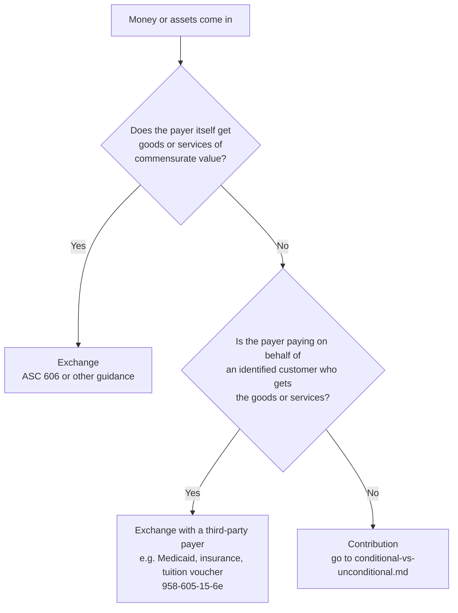

# Contribution or exchange?

## The rule in one line

It is an exchange only if the party paying receives value of roughly equal worth in return. Benefit to the public, or to the payer's mission, does not count as value received.

## Decision tree

## What does NOT count as value to the payer

ASU 2018-08 settled these, and they decide most grant questions:

- **Public benefit.** A foundation or government agency is not the same as the public. When the public benefits from what the money pays for, the funder has not received that value.
- **Mission fulfillment.** Advancing the funder's own mission is not value received.
- **Good feeling.** The donor's satisfaction from giving is not value received.

## Indicators in the current standard (958-605-15-5A, as rewritten by ASU 2018-08)

ASU 2018-08 replaced the older, longer indicator list. What the standard now says:

| Points toward exchange | Points toward contribution |
|---|---|
| Contract penalties for nonperformance go beyond returning the money transferred | The funder had full discretion over the amount; it wasn't set by the value of a deliverable |
| | The type of funder (foundation, government, corporation) doesn't matter on its own |

Plus the three "not value to the payer" rules above.

## Practice judgment (not in the current standard; use as supporting evidence only)

- Both parties described the deal as a purchase of goods or services at a negotiated price.
- The payer owns or directly uses the work product.
- The recipient solicited the money without offering anything of equal value back.

Older guides and audit memos still cite these from the pre-2018 indicator table. They can support a conclusion, but don't rest a memo on them alone.

## Common cases

| Situation | Usual answer | Why |
|---|---|---|
| Foundation program grant with reporting requirements | Contribution | Reporting is not value to the foundation; the public is the beneficiary |
| Government grant to run a public program | Contribution (often conditional) | Same reasoning; check for barriers next |
| Government contract to deliver services to the agency itself | Exchange | The agency receives the services |
| Medicaid or insurance reimbursement for client services | Exchange | Third-party payer on behalf of an identified customer |
| Sponsor payment with tickets, ads, or exclusive rights | Split: exchange for the benefits, contribution for the rest | See `sponsorships.md` |
| Gala ticket | Split: exchange for the meal and event, contribution for the rest | See `quid-pro-quo-and-events.md` |
| Membership dues with real member benefits | Split, or exchange if benefits roughly equal the dues | Value the benefits |

## Coding notes

- Exchange revenue goes in program service revenue, fees, or contract revenue lines, not contribution lines. That choice also drives Form 990 Part VIII (contributions on line 1, program service revenue on line 2).
- When you split a payment, record the two pieces separately at the time of receipt. Reconstructing the split at year-end is where errors come from.
- Write down which indicators drove the call. When the auditor asks, the memo is the evidence.

## Pin log

| Date | What changed | Source |
|---|---|---|
| 2026-10-19 | Fact-check corrections: indicator table reduced to what 958-605-15-5A now says; superseded indicators moved to "practice judgment"; third-party payer citation added | Independent review against ASU 2018-08 (FASB PDF) |
| 2026-10-19 | File created | ASU 2018-08 via BDO and PwC Viewpoint summaries; primary ASC text not yet read here |
