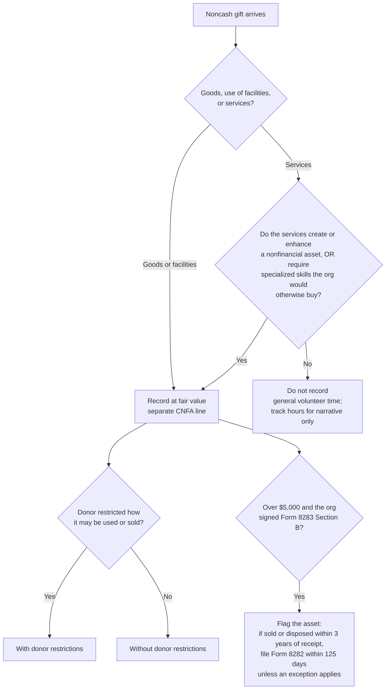

# In-kind gifts

## The rule in one line

Record donated goods, use of facilities, and qualifying services at fair value when received, show them on their own line apart from cash gifts, and disclose them by category. Exception: contributed collection items (art, historical treasures) that meet the collections criteria in 958-605-25-19 need not be recognized; that matters for museums and historical societies. The IRS side (Forms 8283 and 8282, Schedule M) runs on separate thresholds.

## Decision tree

## Valuation

- Use fair value at the date of the gift. The organization values the gift for its books; that is independent of what the donor claims.
- The organization should not state a dollar value on the donor's acknowledgment for noncash gifts. Describe the item; valuation is the donor's job (see Pub. 1771 and Pub. 561).
- A donor's appraisal can inform your fair value but doesn't bind you.
- Document the valuation technique and inputs; ASU 2020-07 requires disclosing them.

## Disclosure checklist (ASU 2020-07)

For each category of contributed nonfinancial assets recognized:

- [ ] Amount, by category (e.g., food, supplies, professional services, facilities)
- [ ] Whether the items were used or sold during the period; for items used, which programs or activities used them
- [ ] The organization's policy, if any, on selling rather than using donated items
- [ ] Any donor restrictions attached
- [ ] Valuation techniques and inputs, and the principal market used if the organization is barred from selling or using the item there

## IRS paperwork that follows the gift

| Trigger | Requirement | Row in volatile-values.md |
|---|---|---|
| Donor's noncash gift over $5,000 | Org signs Form 8283 Section B (acknowledging receipt, not value) | `form-8283-b` |
| Org sells or disposes of that property within 3 years of receiving it | File Form 8282 within 125 days; send the donor a copy. Not required for items the donor certified at $500 or less, or items consumed or distributed for charitable purposes | `form-8282` |
| Aggregate noncash gifts above the threshold, or any art, historical treasures, or conservation contributions | File Schedule M with Form 990 | `sched-m` |
| Noncash gift of $250+ | Written acknowledgment describing the property (no value) | `cwa-threshold` |

## Coding notes

- Use separate revenue accounts for contributed nonfinancial assets so the statement of activities line comes straight from the GL.
- Offset to the matching expense (if consumed) or asset (if held) at the same fair value.
- Keep a disposal log for items received with a signed Form 8283 Section B; the 3-year clock is easy to miss.
- Services from an affiliate's personnel that directly benefit the organization follow a separate rule; ask your accountant if an affiliated organization lends you staff.
- Volunteer hours that don't meet the services test can still appear in narrative reporting and grant match documentation; they just don't hit the GL.

## Pin log

| Date | What changed | Source |
|---|---|---|
| 2026-10-27 | Services criteria (958-605-25-16) confirmed; pending removed | PwC Viewpoint NP 7.5 (quotes 958-605-25-16); The CPA Journal, May 2022 |
| 2026-10-19 | Form 8282 clock corrected to date of receipt; exceptions added; collections exception added | Form 8282 instructions (pinned); independent review |
| 2026-10-19 | File created | ASU 2020-07 (FASB storage PDF, read via search excerpt); Moss Adams and IRS pages on Forms 8282/8283; Schedule M instructions (2024; 2025 draft). ASC 958-605-25-16 services criteria from memory, pending verification |
