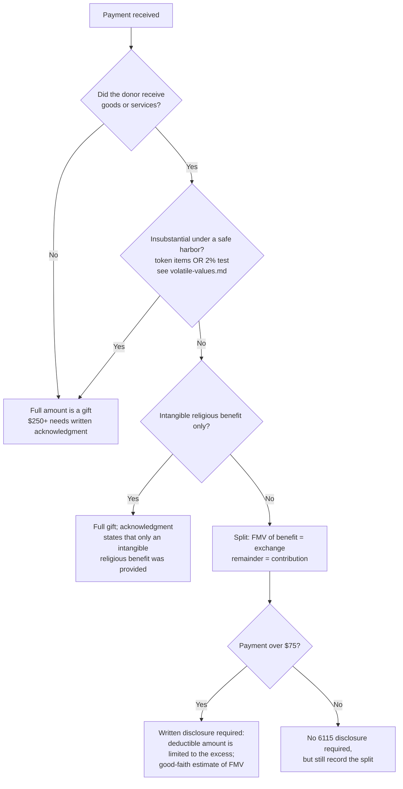

# Quid pro quo gifts, events, and acknowledgments

## The rule in one line

When a donor gets something back, only the amount above the fair market value of what they received is a gift. If the payment is over $75, the charity must tell the donor that in writing, unless the benefit is small enough to ignore under the IRS safe harbors.

## Decision tree

## Safe harbors for ignoring a benefit

Use the current year's figures in `volatile-values.md` (rows `low-cost-article`, `token-min-payment`, `two-percent-cap`, `membership-exception`).

**Both of the first two safe harbors only apply when** the payment is made as part of a fundraising campaign **and** the charity tells the donor how much of the payment is deductible (Pub. 1771, PDF p. 6; Rev. Proc. 90-12 sec. 3). Without that statement, value the benefit.

1. **Token items.** The donor pays at least the minimum, receives only items bearing the org's name or logo (mug, calendar, tote), and the org's total cost for those items is within the low-cost article ceiling. Measured by the charity's cost, not the item's retail value.
2. **2% test.** The fair market value of everything the donor receives is no more than 2% of the payment and no more than the annual dollar cap.
3. **Free, unordered items** mailed with a solicitation fall within the low-cost article rules (Rev. Proc. 92-49).
4. **Membership-benefits exception.** An annual payment of $75 or less that buys only recurring member privileges (free or discounted admission, gift-shop or parking discounts, member-only events within the low-cost limits) is treated as insubstantial. Membership dues at that level don't need to be split (Pub. 1771, PDF p. 6).

Rev. Proc. 90-12 states that benefits in cash or cash equivalents are never insubstantial (text read via the Tax Notes reproduction; not yet checked against the IRS copy). Treat gift cards as valued benefits.

## What the $250+ acknowledgment must say (Pub. 1771, PDF pp. 3-5)

- Name of the organization and the amount of cash, or a description (not the value) of noncash property.
- **A statement of whether the organization provided any goods or services in return.** This is the element receipts most often miss. "No goods or services were provided" is enough when true.
- If goods or services were provided: a description and good-faith estimate of their value, or a statement that only intangible religious benefits were provided.
- It must reach the donor by the earlier of the date they file their return or the return's due date (with extensions).

## What the written disclosure must say (payments over $75)

- The deductible amount is limited to what the donor paid in excess of the value of the goods or services received.
- A good-faith estimate of that value.
- It can be combined with the $250 acknowledgment in one letter.

## Event coding

| Item | Treatment |
|---|---|
| Gala ticket | Split at the ticket's fair value of the benefits (meal, entertainment): exchange revenue for the benefit, contribution for the rest |
| Auction item purchase | Buyer's payment above the item's fair value is a contribution; up to fair value is exchange revenue. Donated auction item is an in-kind gift recorded when received |
| Sponsorship of the event | See `sponsorships.md` |
| Raffle ticket | Not a contribution at all; gaming rules apply |
| Donor declines the benefit at purchase | If declined in advance and the org documents it, the full amount can be a gift. Not attending, without declining, doesn't count |

Fair value is what the benefit would cost in a normal market (a comparable dinner at a comparable venue), not what the org paid. A donated venue doesn't make the dinner worth $0.

## Coding notes

- Book the exchange and contribution portions to separate accounts at receipt. Most CRMs support a "non-deductible" or "benefit value" field on the gift; map it to the exchange account in the GL integration.
- On Form 990, the contribution portion of event payments goes on Part VIII line 1c (and is shown again in parentheses on line 8a); the exchange portion goes on line 8a, with direct benefit costs on line 8b. Keep event expenses tagged to the event; indirect fundraising costs go in Part IX column (D), not line 8b. If donors receive only items of nominal value, the whole amount is reported as contributions and nothing goes on line 8 (Instructions for Form 990, TY2025, PDF pp. 38 and 41).
- Keep the fair-value estimate memo for each event with the event's records.

## Pin log

| Date | What changed | Source |
|---|---|---|
| 2026-10-19 | Fact-check corrections: campaign-and-disclosure condition on safe harbors, membership exception, acknowledgment content, cash-equivalent sourcing, Form 990 line placement | Independent review against Pub. 1771 (pinned) and Rev. Proc. 90-12 |
| 2026-10-19 | File created | IRC 6714 text (Tax Notes); Pub. 1771 (Rev. 11-2023) and Rev. Proc. 2025-32 read from IRS PDFs pinned in `snapshots/`; NC Bar summary of 6115 |
