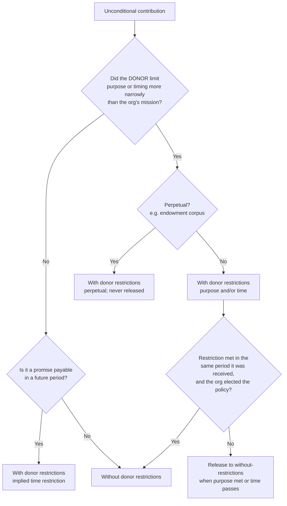

# With or without donor restrictions?

## The rule in one line

Only a donor can restrict a gift. A restriction exists when the donor limits the gift to a purpose or a time period more specific than the organization's general mission. The board can earmark unrestricted money, but that remains "without donor restrictions" (board-designated).

## Decision tree

## Tests for whether the donor actually restricted it

- **Source documents decide.** Gift agreement, response card, appeal language, online form designation, email from the donor. Keep it with the gift record.
- **Appeal language counts.** If the appeal said "give to the new van fund," gifts responding to it are purpose-restricted even if the donor wrote nothing.
- **Mission-level purpose is not a restriction.** "For your programs" or "to support your work" at an org that only does that work is unrestricted.
- **Board action never creates a donor restriction.** Board-designated funds (operating reserve, quasi-endowment) stay without donor restrictions and are disclosed by amount and purpose.

## Release mechanics

| Restriction type | Released when |
|---|---|
| Purpose | Qualifying expenses are incurred |
| Time (explicit date) | The date passes |
| Time (implied, pledge payments) | The payment is due / received in the period it was meant for |
| Long-lived asset purchase | The asset is placed in service (unless the donor stipulated a longer restriction) |
| Perpetual (endowment corpus) | Never; earnings follow the gift instrument and state UPMIFA law |

## Same-period policy option

An organization can elect to report restricted gifts whose restriction is met in the same reporting period as "without donor restrictions," provided it treats investment gains the same way, applies the policy consistently, and discloses it (958-605-45-4A). ASU 2018-08 added a separate version of this election limited to gifts that started out conditional (958-605-45-4B). Note which policy, if any, each client has elected in their client file; it changes how you code every restricted gift.

## Coding notes

- Use a fund or class dimension in the GL for each restriction, not separate revenue accounts per fund. Revenue accounts describe the type of income; the fund dimension describes the restriction.
- Release entries are reclassifications between net asset classes, not revenue.
- A gift with both purpose and time restrictions is released only when both are satisfied.
- The CRM's "designation" field and the GL's restriction are not automatically the same thing. A CRM designation can be the donor's soft preference. Map designations to restriction status explicitly (see `gaap-vs-fundraising-counting.md`).

## Pin log

| Date | What changed | Source |
|---|---|---|
| 2026-10-19 | Same-period election paragraphs confirmed (45-4A, 45-4B); placed-in-service wording corrected | Independent review against ASU 2018-08 and ASU 2016-14 (FASB PDFs) |
| 2026-10-19 | File created | ASU 2016-14 summaries (Keiter, Warren Averett, GHJ); PwC Viewpoint excerpt of 958-605-45-4; primary ASC text not yet read here |
