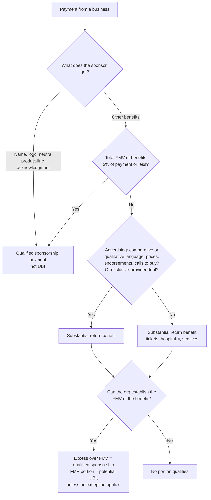

# Corporate sponsorships

Sponsorships need two separate answers: one for the IRS (is any of this taxable unrelated business income?) and one for GAAP (how much is contribution vs. exchange revenue?). They usually line up, but they are different tests.

## The rule in one line

A business can be thanked by name and logo without the payment becoming taxable. Once the business receives advertising, exclusivity as a provider, or other benefits worth more than 2% of the payment, the value of those benefits stops being a qualified sponsorship payment.

## Decision tree (IRS side)

## Acknowledgment vs. advertising

| Allowed (acknowledgment) | Turns it into advertising |
|---|---|
| Sponsor name, logo, slogan that doesn't compare or praise | Qualitative or comparative descriptions ("the best coffee in town") |
| Address, phone, website | Price information or discounts |
| Value-neutral list of product lines | Endorsements |
| Display or distribution of the sponsor's products at the event | Inducements to buy, sell, or use the products |
| Exclusive *sponsor* of the event | Exclusive *provider* arrangement (only their product may be sold or used) |

Two things are never qualified sponsorship payments, whatever the sponsor receives:

- **Contingent payments.** A payment whose amount depends on attendance, broadcast ratings, or other measures of public exposure. (A payment can depend on the event actually happening.)
- **Periodical ads and trade shows.** Payments for ads in the organization's magazines or newsletters, and qualified convention or trade-show activity, fall under other rules.

A payment that is not a qualified sponsorship payment is not automatically taxable. It is unrelated business income only if the activity is a regularly carried on trade or business; a one-time event often isn't. Run that question with the tax preparer.

## GAAP side

- **Benefits with real value** (tickets, tables, booth space, hospitality, advertising): that portion is an exchange, recognized under ASC 606 when the benefit is delivered.
- **The remainder** is a contribution, and may be restricted if the sponsor tied it to a specific program.
- Acknowledgment alone (name and logo) is generally not treated as commensurate value, so a pure name-and-logo sponsorship is usually entirely a contribution.

## Sponsorship packet checklist

- [ ] List every benefit in each sponsorship tier with an estimated fair value
- [ ] Check each tier's benefits against the 2% test
- [ ] Review the sponsor-facing copy for advertising language before it's printed
- [ ] Confirm no exclusive-provider language in the agreement unless the tax preparer has signed off
- [ ] Record the exchange and contribution portions separately at receipt

## Pin log

| Date | What changed | Source |
|---|---|---|
| 2026-10-19 | Fact-check corrections: paragraph numbers fixed to (c)(2)(ii), (d)(1), (c)(2)(vi); contingent-payment and periodical/trade-show exclusions added | eCFR text of 26 CFR 1.513-4, read 2026-10-19 |
| 2026-10-19 | File created | IRS pages "Advertising or qualified sponsorship payments?" and "Exclusive provider arrangement within qualified sponsorship agreements"; CapinCrouse and The Tax Adviser summaries of Treas. Reg. 1.513-4. GAAP split is standard practice, not a quoted standard |
